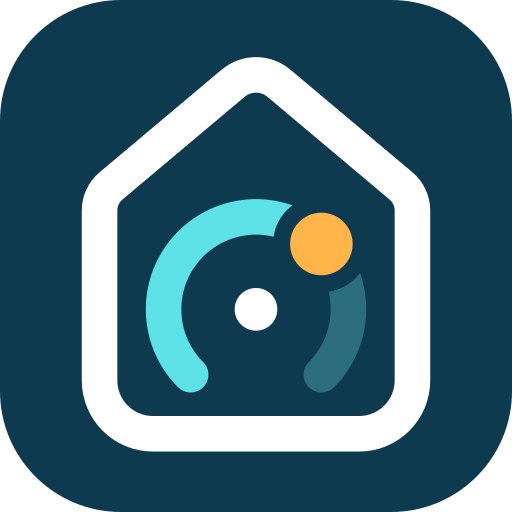
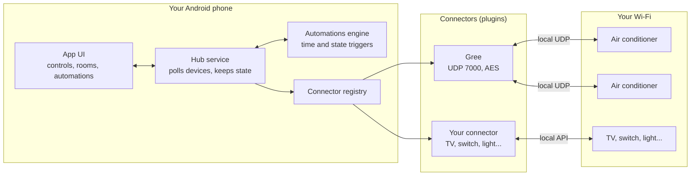

<div align="center">



# Home Controller

**Your home hub, in your pocket. No server. No cloud.**

An open-source Android app that controls your air conditioners, TVs, switches and more directly on your Wi-Fi,
and runs your automations on the phone itself.

[](https://github.com/Alihkhawaher/Home-Controller/actions/workflows/build.yml)
[](https://github.com/Alihkhawaher/Home-Controller/releases/latest)
[](LICENSE)
[](#install)

[Why](#why) · [Features](#features) · [Devices](#supported-devices) · [How it works](#how-it-works) ·
[Install](#install) · [Build](#build-from-source) · [Connectors](#writing-a-connector) · [Roadmap](#roadmap) ·
[Privacy](#privacy)

</div>

---

## Why

Smart-home devices usually leave you two choices, and both have a catch.

- **A home server.** Home Assistant is excellent, but it needs a machine running around the clock: a Raspberry
  Pi, a NAS or a mini PC that you install, update, back up and keep powered.
- **The vendor's app.** Every brand ships its own app, and most of them route every tap through the vendor's cloud.
  You need an account, your device data leaves the house, and when the internet or the vendor's servers go down,
  the air conditioner in the next room stops listening.

Home Controller takes a third way. **The phone is the hub.** The app finds your devices on your Wi-Fi and talks to
them directly, over the same local protocols their own apps use on the LAN. A background service keeps watch and
runs your automations. There is nothing to host, no account to create, and it keeps working with the internet
unplugged.

## Features

- **Local control, no cloud.** Devices are found and controlled on your Wi-Fi only. No account, no sign-in, no
  vendor servers.
- **Your phone is the hub.** An optional foreground service polls your devices, hears the ones that report changes
  on their own (Tuya), and runs automations while the app is closed.
- **Automations.** Trigger on a time of day, at sunrise or sunset with an offset ("sunset − 15 min"), on chosen
  weekdays (with Every day / Workdays / Weekend shortcuts that follow your region's weekend), or on a device state
  ("room above 28 °C"); add conditions (another device's state, a time window that may cross midnight), then change
  devices or send yourself a notification. An automation can run once and turn itself off. A time the phone missed
  while asleep or restarting still runs if the hub is back within 10 minutes, and never twice.
- **One app for every brand.** Device families are plugins, called connectors. The app draws each device's controls
  from what the device declares it can do, so a new brand needs a connector and nothing else.
- **Rooms.** Group devices by room, rename them, hide the ones you never touch.
- **Instant feedback.** Controls respond the moment you tap and settle on the device's confirmed state, with clear
  messages when a device is offline.
- **Diagnostics.** Fault codes, filter reminders and module firmware where the device reports them.
- **Material You.** Light and dark themes with dynamic colour on Android 12 and later.
- **Open source.** Apache-2.0, built in the open, with a small plugin contract that is easy to extend.

## Supported devices

| Family | Connector | Controls | Diagnostics |
|---|---|---|---|
| **Gree Wi-Fi air conditioners**<br>Gree, and Gree-made units sold under other brands that use the Gree+ or EWPE Smart app | [`gree`](docs/connectors/gree.md) | Power, mode (auto, cool, dry, fan, heat), target temperature (16-30 °C), fan speed (auto and five levels), vertical and horizontal swing, display light, turbo, quiet, sleep, ioniser (health), X-Fan | Room temperature, fault code, filter reminder, module firmware, unit clock |
| **Tuya Wi-Fi plugs, switches and energy meters**<br>Tuya-made devices under any brand that use the Tuya Smart or Smart Life app (protocol 3.3, 3.4, 3.5) | [`tuya`](docs/connectors/tuya.md) | Power, countdown, power-on state, LED mode, child lock, over-charge cutoff, and the device's own cycle, random and inching timers (stored on the device, so they run with no internet) | Live power, current, voltage, energy; 3-phase meters (OWON PC321-TY): per-phase voltage, current, power, power factor, energy, frequency |

More families are on the [roadmap](#roadmap). Want one sooner? [Request a connector](https://github.com/Alihkhawaher/Home-Controller/issues/new?template=connector_request.yml)
or [write one](docs/writing-a-connector.md).

> [!NOTE]
> **Gree firmware.** The connector uses the local UDP protocol (port 7000) that Gree Wi-Fi modules have spoken for
> years. Some very new module firmware closes that port and only talks to the cloud. If a unit never shows up in a
> search while others on the same Wi-Fi do, its module is probably one of these. See
> [the Gree notes](docs/connectors/gree.md#troubleshooting).

## How it works



1. **Connectors** know one device family each. A connector finds its devices on the local network and opens a
   session to one of them.
2. A session declares the device's **capabilities**: power, a choice (mode, fan speed), a number (target
   temperature), a toggle (turbo), a reading (room temperature). The UI renders controls from that list.
3. The **hub service** keeps the sessions open, reads each device's state on a timer (every few seconds while the
   app is open, about once a minute in the background) and sends your changes.
4. Once a minute the **automations engine** compares the clock and the latest states with your rules and returns the
   ones that are due. The hub carries out their actions.

Everything runs on the phone. The core contract and the automations engine are plain Kotlin with no Android
dependencies, so they are unit-tested on the JVM. Read more in [docs/architecture.md](docs/architecture.md).

## Install

1. Download the latest `.apk` from the [Releases page](https://github.com/Alihkhawaher/Home-Controller/releases/latest).
2. Open it on your phone. Android asks you to allow installs from the app you downloaded it with (your browser or
   file manager): allow it for this install.
3. Open Home Controller and search for devices. Your phone and your devices must be on the same Wi-Fi.

Requires Android 8.0 or later. To let automations run while the app is closed, turn on the background hub in the
app's settings, allow its notification, and if your phone still stops it, exclude Home Controller from battery
optimisation.

## Build from source

You need **JDK 17** and the **Android SDK** with platform 34. Android Studio provides both; on the command line,
point `ANDROID_HOME` (or `sdk.dir` in `local.properties`) at your SDK.

```sh
git clone https://github.com/Alihkhawaher/Home-Controller.git
cd Home-Controller
./gradlew assembleDebug        # app/build/outputs/apk/debug/app-debug.apk
./gradlew test                 # unit tests for the core, the connectors and the app
```

On Windows use `gradlew.bat`. Release builds are signed only when a git-ignored `keystore.properties` is present;
without it they come out unsigned.

| Module | What it holds |
|---|---|
| [`core/`](core) | The plugin contract (`Connector`, `DeviceSession`, `Capability`) and the automations engine. Pure Kotlin. |
| [`connectors/gree/`](connectors/gree) | Gree Wi-Fi air conditioners. |
| [`app/`](app) | The Android app: UI, hub service, storage. |
| [`branding/`](branding) | The icon and store graphics, generated by `branding/build.py`. |
| [`docs/`](docs) | Architecture, the connector guide and protocol notes. |

## Writing a connector

A connector is a Gradle module that implements two interfaces from `core`:

```kotlin
interface Connector {
    val info: ConnectorInfo
    suspend fun discover(network: LocalNetwork, timeoutMs: Long = 3_000): List<DeviceRef>
    suspend fun open(device: DeviceRef): DeviceSession
}

interface DeviceSession : AutoCloseable {
    val device: DeviceRef
    val capabilities: List<Capability>
    suspend fun read(): DeviceState                        // reads only
    suspend fun apply(changes: List<SetValue>): DeviceState // the only call that changes a device
    fun updates(): Flow<DeviceState>? = null                // optional: what the device pushes on its own
}
```

Declare what the device can do, map its protocol to `read` and `apply`, register the connector, and the app does
the rest: device cards, controls, automations. The rules are short: local network only, never log a key or a
password, and `read()` never changes a device.

The step-by-step guide, with a complete example connector and its tests, is in
[docs/writing-a-connector.md](docs/writing-a-connector.md).

## Roadmap

**Connectors**

- [x] Gree Wi-Fi air conditioners
- [ ] LG webOS TVs
- [ ] Samsung TVs
- [ ] Tuya devices (local LAN protocol)
- [ ] Broadlink IR and RF remotes
- [ ] Shelly relays, plugs and dimmers
- [ ] Sonoff (LAN mode)
- [ ] Philips Hue (local bridge API)
- [ ] MQTT

**App**

- [ ] Home-screen widgets and quick-settings tiles
- [ ] Wear OS companion
- [ ] Backup and restore
- [ ] F-Droid release

Ideas and votes are welcome in [Issues](https://github.com/Alihkhawaher/Home-Controller/issues).

## Screenshots

Screenshots come with the first release. They will live in [`docs/screenshots/`](docs/screenshots).

## Privacy

- **No analytics, no tracking, no ads.** The app contains no analytics or crash-reporting SDKs.
- **No cloud, no account.** Nothing is sent to Technlov or anyone else.
- **All traffic stays on your LAN.** The app talks only to devices on your local network. Android names the
  permission for any network socket "Internet"; Home Controller uses it for local connections.
- **Your data stays on your phone.** Devices, rooms and automations are stored in the app's private storage.
  Device keys that a device hands out on the LAN are never logged.
- **Location only if you ask.** Sunrise and sunset are worked out on the phone from your home's location. You type
  it, or tap "Use this phone's location": the app then asks for approximate location and reads it once. It is
  rounded to about a kilometre, kept on the phone, and never logged or tracked.

Note that many local device protocols, Gree's included, have no authentication: anyone on your Wi-Fi can control
those devices with or without this app. Keep your Wi-Fi password strong and put guests on a guest network. See
[SECURITY.md](SECURITY.md).

## Contributing

Bug reports, connector requests and pull requests are welcome. Start with [CONTRIBUTING.md](CONTRIBUTING.md), and
please follow the [code of conduct](CODE_OF_CONDUCT.md). Report security issues privately, as described in
[SECURITY.md](SECURITY.md).

## Credits

- [greeclimate](https://github.com/cmroche/greeclimate) by cmroche and
  [gree-remote](https://github.com/tomikaa87/gree-remote) by tomikaa87 documented the Gree local protocol. The Gree
  connector would not exist without their work.
- [tinytuya](https://github.com/jasonacox/tinytuya) by Jason Cox: the Tuya connector's LAN protocol is ported from it.
- [tuya-local](https://github.com/make-all/tuya-local) by Nik Rolls, Jason Rumney and contributors: verified data-point maps
  (OWON PC321-TY) and real Tuya-app captures of the native timer formats.
- The connector and capability model follows the idea of [Home Assistant](https://www.home-assistant.io/)'s
  integrations and entities, moved onto the phone.
- [commons-suncalc](https://github.com/shred/commons-suncalc) by Richard Körber (Apache-2.0) computes sunrise and
  sunset on the phone.

Gree, Tuya and other brand names are trademarks of their owners. Home Controller is an independent project and is not
affiliated with or endorsed by any device maker.

## License

Copyright 2026 Technlov.

Licensed under the [Apache License, Version 2.0](LICENSE).
