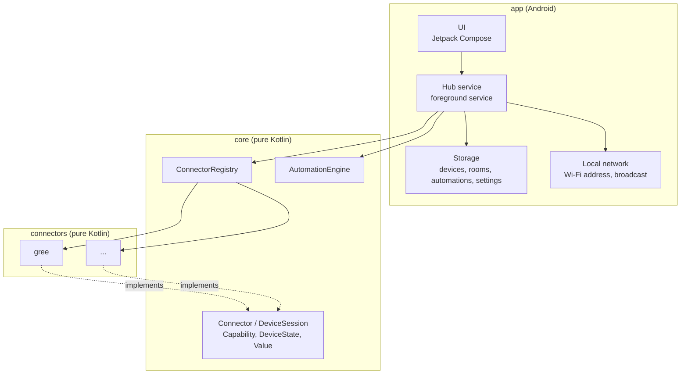
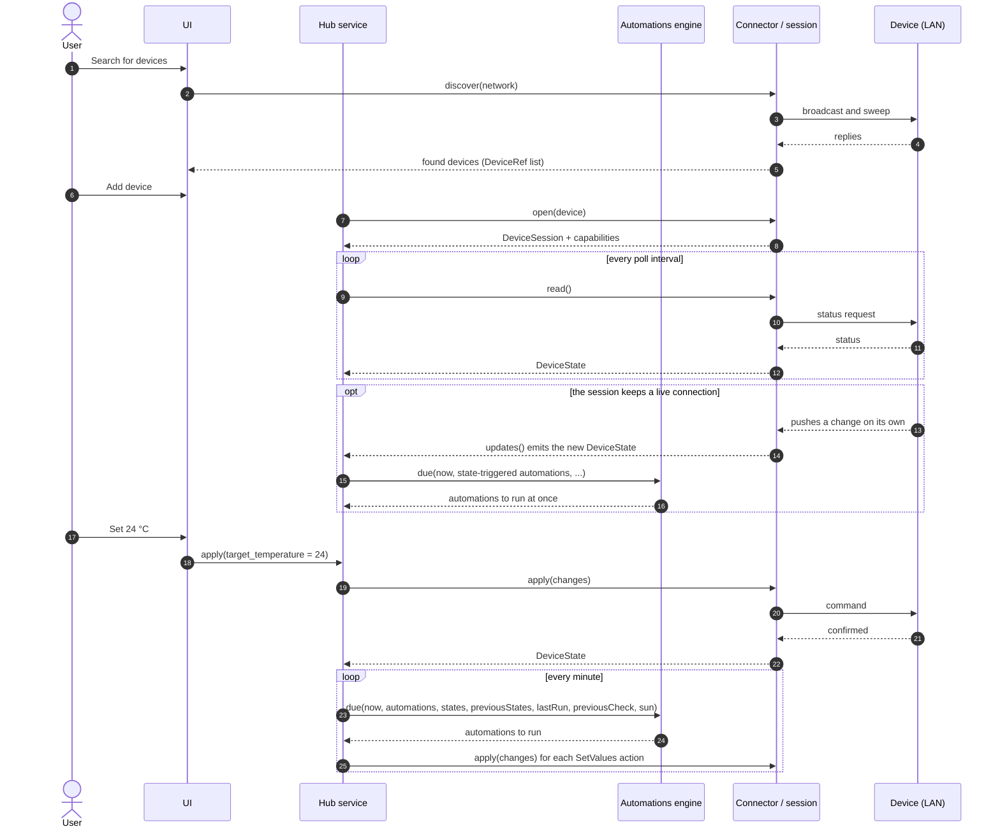

# Architecture

Home Controller is a smart-home hub that runs on an Android phone. It has three layers:

| Layer | Module | Depends on Android? | Job |
|---|---|---|---|
| Core | `core/` | No | The plugin contract and the automations engine. |
| Connectors | `connectors/<id>/` | No | One device family each: find devices, read them, change them. |
| App | `app/` | Yes | UI, the hub service, storage, the phone's network. |

The core and the connectors are plain Kotlin/JVM libraries. Everything that decides *what* happens (which
automation fires, how a Gree status maps to a temperature) is tested on the JVM with `./gradlew test`, without an
emulator or a device.



## The core contract

The contract lives in [`core/src/main/kotlin/com/technlov/home/core/Connector.kt`](../core/src/main/kotlin/com/technlov/home/core/Connector.kt).

### Connector

A `Connector` knows one family of devices.

```kotlin
interface Connector {
    val info: ConnectorInfo
    suspend fun discover(network: LocalNetwork, timeoutMs: Long = 3_000): List<DeviceRef>
    suspend fun open(device: DeviceRef): DeviceSession
}
```

- `info` describes the connector on the app's plugins screen: a stable lowercase `id` (`"gree"`), a name, a one-line
  description, the device categories it covers, its version and a short protocol summary
  (`"Local UDP 7000, AES-128 (no cloud, no account)"`).
- `discover` looks for devices on the local network and returns whatever answered within `timeoutMs`. The app passes
  a `LocalNetwork`: the broadcast address, the /24 prefix for a sweep, and any hosts it already knows.
- `open` starts a session with one device, found by `discover` or remembered by the app.

### DeviceRef

A `DeviceRef` is a device as the app remembers it.

- `id` is stable across IP address changes: a MAC address, a serial number. Together with the connector id it forms
  the device's `DeviceKey`, `"connectorId:deviceId"`, which automations use to address it.
- `address` is where the device was last seen. It may change with DHCP; a connector should check that the device
  answering at an address is the one it expects.
- `extras` holds connector-specific details needed to reconnect, such as a protocol version. Never secrets.

### DeviceSession

```kotlin
interface DeviceSession : AutoCloseable {
    val device: DeviceRef
    val capabilities: List<Capability>
    suspend fun read(): DeviceState
    suspend fun apply(changes: List<SetValue>): DeviceState
    fun updates(): Flow<DeviceState>? = null
    override fun close() {}
}
```

- `read` returns the current state and never changes the device. The hub calls it on a timer.
- `apply` changes one or more values in one go and returns the state afterwards. It is the only call that changes a
  device.
- `updates` is optional. A session that keeps a live connection returns a hot flow of the states the device pushes
  on its own (a button pressed, an alarm going off), each a whole state; a polled-only session keeps the default,
  `null`. The flow belongs to the session: collecting it opens nothing, and it goes quiet when the session closes. It
  never carries an "offline" state; the hub finds an unreachable device by polling. States from one session (from
  `read`, `apply` and `updates`) have non-decreasing `updatedAtMillis`, so the hub can tell a push that crossed a poll
  from a newer one. The Tuya connector pushes; Gree is polled.
- `close` releases sockets and other resources.

A `DeviceState` is a map of capability key to `Value` (`Bool`, `Num` or `Text`), plus `online`, the time it was
read, and an `error` message when something went wrong.

## Capabilities

A session declares what its device can do as a list of capabilities. The UI renders each kind generically, so a new
device family needs no UI work.

| Capability | Meaning | Example |
|---|---|---|
| `Power` | On/off for the whole device. | Air conditioner power |
| `Choice` | One of a fixed list of options. | Mode, fan speed, swing position, TV input |
| `Number` | A number in a range with a step and a unit. | Target temperature, volume, brightness |
| `Toggle` | A secondary on/off. | Display light, turbo, quiet, sleep |
| `Reading` | A read-only value. `diagnostic = true` puts it in the device's diagnostics section. | Room temperature, fault code, firmware |

`Choice`, `Number` and `Toggle` have a `writable` flag for values a device reports but does not accept.

Well-known keys in `Keys` let the UI draw richer controls when it recognises them:

| Key | Used for |
|---|---|
| `power` | The main on/off switch |
| `mode`, `fan_speed` | Mode and fan chips |
| `target_temperature` + `current_temperature` | The climate dial |
| `swing_vertical`, `swing_horizontal` | Swing pickers |
| `display_light` | The unit's display |
| `fault`, `firmware` | Diagnostics |
| `volume`, `brightness`, `input` | TVs, lights and media devices |

A connector may add its own keys (the Gree connector adds `turbo`, `quiet`, `sleep`, `health`, `x_fan`,
`clean_filter` and `clock`). They render with the generic control for their kind and can be used in automations
like any other key.

## The connector registry

`ConnectorRegistry` holds every connector built into the app, sorted by name and looked up by id. Connectors are
compiled in: each one is a Gradle module listed in `settings.gradle.kts`, added as a dependency of `app`, and passed
to the registry in
[`Connectors.kt`](../app/src/main/java/com/technlov/homecontroller/Connectors.kt) when the app starts. There is no
dynamic code loading. Debug builds add a simulated-devices connector (two air conditioners and a dimmable lamp, in
memory, nothing on the network) so the app can be tried on an emulator; release builds do not include it.

## The hub service

The hub is the part of the app that makes it more than a remote control.

- It keeps a session open to every device the user added, opening it again after a failure with a growing delay
  (5 seconds, then 10, 20 and so on, up to 5 minutes).
- It reads each device on a timer: every few seconds while the app is on screen, and about once a minute in the
  background. Both intervals are settings.
- It follows the pushes of every session that offers `updates()`, for as long as that session is open: a pushed state
  is shown at once, kept in the power history, and checked against the state-triggered automations straight away, so
  an alarm going off notifies within a second rather than at the next poll. Polling carries on as the fallback.
- It keeps the latest and the previous state of every device. The UI shows the latest state with any changes still
  on their way laid over it, so a control moves the moment it is tapped and settles on what the device confirms.
- It runs as an Android foreground service when the user turns on background running, so automations fire while the
  app is closed. Android requires a visible notification for that.
- Once a minute it asks the automations engine which automations are due, then carries out their actions. When a
  device pushes a change it asks again at once, for the state-triggered automations only. Both checks share one
  baseline of previous states, so an edge fires an automation once, whichever check sees it first.

## The automations engine

Automations are defined in [`Automation.kt`](../core/src/main/kotlin/com/technlov/home/core/Automation.kt) and
evaluated by `DefaultAutomationEngine`, a pure function of the clock and the device states.

```kotlin
data class Automation(
    val id: String,
    val name: String,
    val enabled: Boolean = true,
    val trigger: Trigger,
    val conditions: List<Condition> = emptyList(),
    val actions: List<Action>,
    val runOnce: Boolean = false,
)
```

| Part | Kinds |
|---|---|
| Trigger | `TimeOfDay(hour, minute, days)`: at a time, on chosen weekdays (none means every day). `Sun(event, offsetMinutes, days)`: at sunrise or sunset, moved by up to three hours either way ("sunset − 15 min"), on chosen weekdays. `StateMatches(device, key, op, value)`: when a device value comes to match, such as room temperature `GE 30`. |
| Condition | `StateCompare(device, key, op, value)`: a device value must match now. `TimeBetween(from, to)`: the time is inside a window. |
| Action | `SetValues(device, changes)`: change a device. `Notify(title, text)`: show a notification. |

The operators are `EQ`, `NE`, `GT`, `GE`, `LT` and `LE`.

The engine is called once a minute as `due(now, automations, states, previousStates, lastRun, previousCheck, sun)`.
`lastRun` is when each automation last ran; the app saves it with the automations, so it outlives a restart.
`previousCheck` is when the hub last asked (null right after a start). `sun` is a `SunClock`: the home's sunrise and
sunset in the phone's local time, worked out on the phone by `SolarClock` with
[commons-suncalc](https://github.com/shred/commons-suncalc) from the location the user set (none set: sun triggers
do not fire).

The rules:

- An automation is due when it is enabled, its trigger fires, and every condition holds.
- A time trigger fires once for each time it is set for: during that minute, or, when the hub missed it (Android
  dozed, or the app was restarted), late, up to 10 minutes after it. Missed means the time passed after the previous
  check and the saved last run is older than it. A time the hub checked on time is never retried, even if a
  condition did not hold then. Right after a start, a late run also needs a saved last run, so a time that may have
  run before an app update is not run again. It never runs twice for the same time.
- A sun trigger follows the same rules at the sunrise or sunset plus its offset; its days are the days of the
  sunrise or sunset, so "sunset + 2 h" past midnight belongs to its evening. Where the sun does not rise or set that
  day, it does not fire.
- A run-once automation is turned off by the hub after a run in which every device took its change; after a failed
  run it stays on and tries again next time.
- A state trigger fires on the edge only: the comparison is true now and was not true in the previous state. It does
  not fire again on every poll while the value stays the same.
- A time window is inclusive at the start and exclusive at the end, may cross midnight (22:00 to 06:00), and a window
  that starts and ends at the same time covers the whole day.
- A device that is offline does not count: its values are stale, so a trigger or condition on it is not met.
- Numbers compare numerically, and text that holds a number counts as that number when compared with one. Text and
  on/off values support only `EQ` and `NE`; text compares ignoring case and surrounding spaces. Values of different
  kinds are never equal.

## Data flow



## Threading and errors

- Every contract call is a `suspend` function. Connectors do their network I/O on `Dispatchers.IO` and never block
  the main thread.
- A connector signals a failure it can explain with `ConnectorException`, with a message fit to show the user and no
  secrets in it.
- A device that stops answering during `read` is best reported as a state with `online = false` and the reason in
  `error`, keeping the last known values. The Gree connector does this.
- `apply` validates every change before sending anything, and fails if the device does not confirm.

## Storage

Devices, rooms, automations and settings are stored on the phone in the app's private storage. A saved device keeps
its last reported capabilities, so its controls and the automation editor work while it is offline. When each
automation last ran is stored too, written before its actions run, so a restart never runs a time twice. The home's
location for sunrise and sunset, if the user set it, is stored rounded to about a kilometre and never logged.
Nothing is synchronised to a server.

## Security model

Home Controller trusts the local network, as the devices themselves do. Many local protocols have no
authentication: a Gree unit hands its encryption key to any client on the Wi-Fi that asks. The app therefore treats
device keys as per-session values: they are not logged, not shown, and where possible not stored. See
[SECURITY.md](../SECURITY.md).
